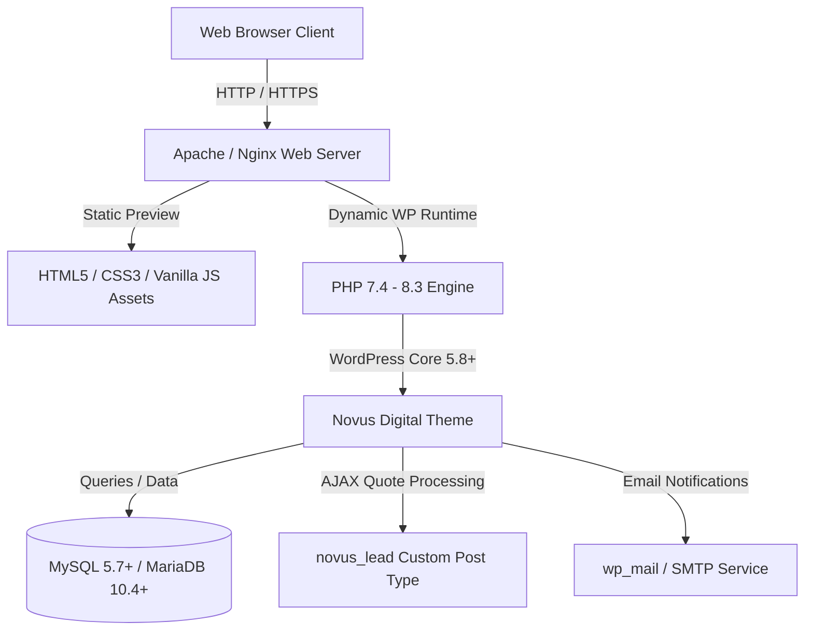
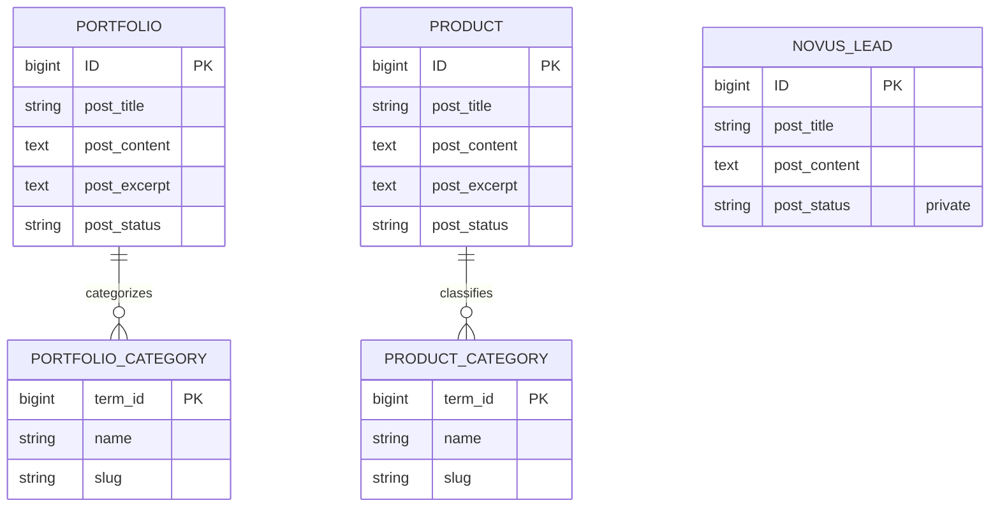
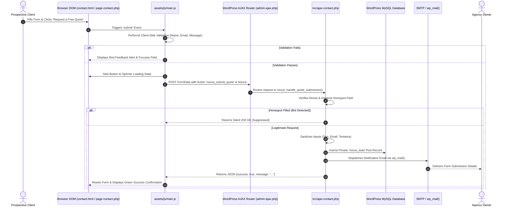

# Technical and Functional Specification Document (TFD)
## Project: Modern, Affordable Website & App Development Company Platform (Novus Digital)

---

### Document Control
- **Document Version:** 1.0.0
- **Document Status:** Final / Production-Ready
- **Classification:** Technical Architecture & Functional Specification
- **Product Name:** Novus Digital Platform & WordPress Theme
- **Authors:** Senior UI/UX Designer, Solutions Architect & Lead WordPress Engineer
- **Date:** October 2026
- **Target Audience:** Product Managers, Software Engineers, UI/UX Designers, DevOps Engineers, and Business Stakeholders

---

## Table of Contents
1. [Executive Summary & Product Vision](#1-executive-summary--product-vision)
2. [Functional Specification Document (FSD)](#2-functional-specification-document-fsd)
   - 2.1 Information Architecture & Site Map
   - 2.2 Navigation & Global Components
   - 2.3 Detailed Page-by-Page Specifications
     - 2.3.1 Homepage
     - 2.3.2 Our Services Page
     - 2.3.3 Our Products Page
     - 2.3.4 About Us Page
     - 2.3.5 Our Portfolio Page
     - 2.3.6 Contact Us Page & Quote Engine
     - 2.3.7 Privacy Policy Page
     - 2.3.8 404 Error Page
   - 2.4 User Roles & Personas
   - 2.5 Conversion Rate Optimization (CRO) & UX Flow
3. [Technical Architecture & Specification (TSD)](#3-technical-architecture--specification-tsd)
   - 3.1 Technology Stack & System Requirements
   - 3.2 Dual Implementation Strategy
   - 3.3 WordPress Theme Architecture & Template Hierarchy
   - 3.4 Custom Post Types (CPT) & Data Schema
   - 3.5 WordPress Customizer Configuration Schema
   - 3.6 AJAX Form Processing & Lead Management Architecture
   - 3.7 CSS Design System & Token Architecture
   - 3.8 Client-Side Scripting Architecture (Vanilla ES6+)
   - 3.9 Asset Management & Vector Graphic Architecture
4. [Security, Performance & Compliance](#4-security-performance--compliance)
   - 4.1 Security Architecture & Vulnerability Mitigation
   - 4.2 Anti-Spam Architecture
   - 4.3 Web Accessibility (WCAG 2.1 AA) Compliance
   - 4.4 Search Engine Optimization (SEO) & Core Web Vitals
5. [Deployment, Installation & Administration Guide](#5-deployment-installation--administration-guide)
   - 5.1 WordPress Theme Installation & Activation
   - 5.2 Content & Menu Mapping
   - 5.3 SMTP Configuration & Email Deliverability
   - 5.4 WooCommerce Extensibility
6. [Future Product Roadmap](#6-future-product-roadmap)

---

## 1. Executive Summary & Product Vision

### 1.1 Vision
The **Novus Digital** platform is designed to establish a market-leading digital presence for a modern technology and software development company. The platform positions the company as an elite digital agency that delivers top-tier custom websites, web applications, mobile apps, and proprietary digital tools at accessible, affordable prices.

### 1.2 Core Value Propositions
The platform is built around three foundational commercial messages:
1. **Modern and Attractive Digital Experiences:** State-of-the-art UI/UX, responsive multi-device execution, and contemporary tech aesthetic.
2. **Affordable Solutions for Businesses of All Sizes:** Transparent flat-rate pricing, zero agency overhead bloat, and lean engineering practices.
3. **Reliable Development, Professional Quality, and Friendly Support:** Direct developer communication, security hardening, SEO foundations, and ongoing maintenance.

### 1.3 Key Architectural Deliverables
1. **Standalone High-Performance Web Application:** Static HTML5/CSS3/Vanilla JS platform with zero build dependencies, enabling sub-second load times and standalone hostability.
2. **Production-Ready Custom WordPress Theme (`novus-digital-theme`):** A custom, standards-compliant, modular WordPress theme with template files, live theme customizer controls, custom post types, and database lead capture.
3. **Pre-Built Theme Archive (`novus-digital-theme.zip`):** Ready for 1-click upload via the standard WordPress Theme Installer.

---

## 2. Functional Specification Document (FSD)

### 2.1 Information Architecture & Site Map

```
Novus Digital Platform
│
├── Home (/)
│   ├── Sticky Header & Navigation
│   ├── Hero Section with Dynamic Mockup
│   ├── Trust & Value Pillars (6 Key Benefits)
│   ├── Services Preview Grid (4 Core Categories)
│   ├── Digital Products Preview (3 Proprietary Tools)
│   ├── Portfolio Preview (3 Case Studies)
│   ├── 4-Step Process Timeline
│   ├── "Why Choose Us" & Comparison Matrix
│   ├── Genuine Testimonials / Review Container
│   ├── Frequently Asked Questions (8 Interactive Accordions)
│   ├── Final High-Impact CTA Banner
│   └── Global Site Footer
│
├── Our Services (/services/)
│   ├── Page Hero & Value Proposition
│   ├── 1. Website Development Detailed Breakdown
│   ├── 2. WordPress Development Detailed Breakdown
│   ├── 3. E-commerce Development Detailed Breakdown
│   ├── 4. Web Application Development Detailed Breakdown
│   ├── 5. Mobile Application Development Detailed Breakdown
│   ├── 6. UI/UX Design Detailed Breakdown
│   ├── 7. Website Redesign & Modernization Detailed Breakdown
│   ├── 8. Maintenance & Technical Support Detailed Breakdown
│   └── Direct Project Inquiry Handoff
│
├── Our Products (/products/)
│   ├── Page Hero & Catalog Introduction
│   ├── Category Filter Tabs (All, SaaS, Tools, Templates)
│   ├── Product Showcase Grid (Features, Demos, Licensing)
│   └── Transparent Sample Concept Disclaimers
│
├── Our Portfolio (/portfolio/)
│   ├── Page Hero & Client Work Introduction
│   ├── Category Filter Tabs (All, Business, E-Commerce, Web Apps, Mobile, Landing)
│   ├── Project Cards with Mockups & Tech Stack Tags
│   └── Concept Demonstration Notices
│
├── About Us (/about/)
│   ├── Company Narrative & Introduction
│   ├── Verbatim Core Mission Statement
│   ├── Company Vision & Long-Term Roadmap
│   ├── 3 Core Values (Craftsmanship, Transparency, Client Dedication)
│   └── Methodology: How We Balance Affordability & High Quality
│
├── Contact Us (/contact/)
│   ├── Page Hero & Consultation Promise
│   ├── Comprehensive Quote Request Engine
│   │   ├── Dynamic Pre-selection via Query Parameters
│   │   ├── Real-Time Client-Side Validation
│   │   ├── Budget Range Pill Selector
│   │   ├── Anti-Spam Honeypot Mechanism
│   │   └── Async AJAX Submission & Live Feedback
│   └── Contact Info Sidebar (Email, Phone, Operating Hours, Social Channels)
│
├── Privacy Policy (/privacy-policy/)
│   ├── Information We Collect
│   ├── Purpose of Processing
│   ├── Cookie Policy & Tracking Technologies
│   ├── Security & Encryption
│   ├── Third-Party Sharing Rules
│   └── User Rights (GDPR / Regional Data Compliance)
│
└── 404 Error Page (/404/)
    ├── Error Diagnostics
    └── Immediate Recovery Actions (Homepage & Contact Redirects)
```

---

### 2.2 Navigation & Global Components

#### 2.2.1 Sticky Global Header
- **Desktop Navigation:**
  - Company Brand Logo with vector polygon emblem and dual-tone typography (`NovusDigital`).
  - Primary links: *Home*, *Our Services*, *Our Products*, *Our Portfolio*, *About Us*, *Contact Us*.
  - Social media icon triggers (Instagram and Facebook) opening in secure new tabs (`target="_blank" rel="noopener noreferrer"`).
  - Primary conversion button: `"Get a Free Quote"`, styled with gradient glow.
- **Scroll Behavior:**
  - Dynamic scroll listener adds `.scrolled` state when viewport vertical offset exceeds 20px, increasing background opacity to 95% and adding an ambient elevation drop-shadow.
- **Mobile Navigation Drawer:**
  - Semantic hamburger toggle button with synchronized 3-line to X transformation animation.
  - Off-canvas slide-in drawer (`width: 85%`, `max-width: 380px`) with high z-index (999) and frosted backdrop blur.
  - Accessible keyboard close behavior listening on `Escape` key and click-outside backdrop event.

#### 2.2.2 Global Footer
- **Column 1 (Brand Identity):** Company logo, mission statement summary, and recognizable SVG social links.
- **Column 2 (Quick Links):** Deep links to all primary pages.
- **Column 3 (Service Offerings):** Anchor links to specific service sections.
- **Column 4 (Contact & Availability):** Active email link (`mailto:`), phone trigger (`tel:`), verified business operating hours, and `"Request Free Consultation"` button.
- **Sub-Footer Row:** Dynamic copyright year generator (`date('Y')` in PHP / `getFullYear()` in JS) and legal compliance link.

---

### 2.3 Detailed Page-by-Page Specifications

#### 2.3.1 Homepage (`index.html` / `front-page.php`)
1. **Hero Section:**
   - **Headline:** *"Beautiful Websites. Powerful Apps. Affordable Prices."*
   - **Subtext:** *"We help startups, entrepreneurs, and growing businesses turn their ideas into modern digital experiences without breaking the budget."*
   - **CTAs:** Dual buttons: Primary *"Get a Free Quote"* (links to `/contact/`) and Secondary *"Explore Our Services"* (links to `/services/`).
   - **Visual Illustration:** Vector SVG mockup featuring an interactive browser window with real-time performance telemetry (99/100 PageSpeed, +142% Conversion Rate, 100% Mobile Pass) layered alongside a smartphone app mockup.
   - **Assurance Badges:** 100% Transparent Quotes, No Hidden Fees, Reliable Ongoing Support.
2. **Trust & Value Section:**
   - 6 structured cards: Affordable & Transparent Pricing, Modern Customized Designs, Mobile-Friendly & Responsive, Fast & Efficient Development, SEO-Friendly Foundations, Friendly & Ongoing Support.
3. **Services Preview:**
   - 4 primary service categories with bulleted sub-deliverables and direct "Learn More" links.
4. **Digital Products Preview:**
   - 3 product cards displaying proprietary tools: *SaaSify Starter Kit*, *OmniBook Pro*, and *AgencyPulse Portal*. Includes feature tags, "Explore Product" buttons, and "Inquire Now" triggers.
5. **Portfolio Preview:**
   - 3 highlighted projects (*Vertex Consulting*, *Aura Lifestyle*, *CloudMetric Operations*) displaying category badges, descriptions, and technology stack pills.
6. **4-Step Process Section:**
   - Visual numbered timeline: **01 Discover**, **02 Plan & Design**, **03 Build & Test**, **04 Launch & Support**.
7. **Why Choose Us Section:**
   - Comparative evaluation matrix comparing Novus Digital against traditional big agencies across 6 parameters (Custom Design, Flat Pricing, Direct Developer Access, Mobile/SEO Inclusion, Delivery Speed, Support Costs).
8. **Testimonials Policy Section:**
   - High-trust placeholder layout explaining the company's commitment to genuine client feedback and providing an inquiry link for direct references.
9. **Frequently Asked Questions (FAQ):**
   - 8 collapsible accordion items covering cost, duration, redesigns, mobile compliance, self-management, maintenance, custom apps, and quote requirements.
10. **Final Call to Action Banner:**
    - High-impact gradient card with dual conversion actions: *"Start Your Project"* and *"Contact Us"*.

#### 2.3.2 Our Services Page (`services.html` / `page-services.php`)
Provides comprehensive documentation for each of the 8 service verticals:
- **Structure per service:**
  - Service title with categorized badge pill.
  - Comprehensive service overview.
  - Detailed *"What the service includes"* checklist.
  - *"Who it is suitable for"* audience qualification.
  - Sidebar card with 4-5 key benefits and a direct link to the quote form passing the service parameter (e.g. `/contact/?service=wordpress-development`).

#### 2.3.3 Our Products Page (`products.html` / `page-products.php`)
- **Category Filter Tabs:** *All Products*, *SaaS Boilerplates*, *Business Tools*, *Web Templates*.
- **Product Card Specifications:**
  - Mockup image preview.
  - Category identifier.
  - Title and detailed narrative.
  - 4-item technical feature list.
  - Action button pair: *"Request Live Demo"* and *"Inquire / License"*.
  - Sample concept disclaimer badge to maintain compliance and authenticity.

#### 2.3.4 About Us Page (`about.html` / `page-about.php`)
- **Core Mission Statement:** Incorporated verbatim:
  > *"We believe every business deserves a strong digital presence. Our goal is to make modern website and application development more accessible by combining thoughtful design, reliable technology, and affordable solutions."*
- **Company Narrative:** Explains the founding thesis of eliminating agency overhead to pass cost savings directly to clients.
- **Mission & Vision:** Dual column layout detailing the company's operational purpose and long-term industry vision.
- **Core Values:** *Authentic Craftsmanship*, *Radical Transparency*, and *Client-First Dedication*.
- **Methodology:** Detailed explanation of the lean operational framework (Zero Bureaucratic Bloat, Modern Tooling & Modular Foundations, Predictable Fixed-Price Contracts).

#### 2.3.5 Our Portfolio Page (`portfolio.html` / `page-portfolio.php`)
- **Category Filter Tabs:** *All Projects*, *Business Websites*, *E-Commerce*, *Web Applications*, *Mobile Applications*, *Landing Pages*.
- **Card Elements:** Responsive SVG mockup, project title, industry category, functional summary, technology stack badges (e.g., `React`, `WordPress`, `Tailwind CSS`, `Node.js`, `WooCommerce`), and direct inquiry triggers.
- **Legal Compliance:** Clear Concept Demonstration disclaimer noting that items showcase internal architectural capabilities.

#### 2.3.6 Contact Us Page (`contact.html` / `page-contact.php`)
- **Form Fields & Validation Rules:**

| Field Label | Input Type | Required | Validation Rule | Purpose |
| :--- | :--- | :--- | :--- | :--- |
| **Full Name** | `text` | Yes | Non-empty string; min 2 chars | Identifies prospective client |
| **Email Address** | `email` | Yes | RFC 5322 regex validation | Primary communication channel |
| **Company Name** | `text` | No | Optional string | Organizational context |
| **Phone Number** | `tel` | No | Optional string / digits | Rapid phone / WhatsApp contact |
| **Service Required** | `select` | Yes | Dropdown selection (10 options) | Scopes project requirements |
| **Contact Method** | `select` | No | Dropdown (`email`, `phone`, `whatsapp`) | Client preference |
| **Budget Range** | `radio` | No | 4 pill options (`< $1k`, `$1k-$2.5k`, `$2.5k-$5k`, `$5k+`) | Qualifies project scale |
| **Project Description**| `textarea`| Yes | Non-empty string; min 10 chars | Core scope & functional goals |
| **Honeypot Trap** | `text` | No | Hidden (`display: none`); must be empty | Anti-spam bot suppression |

- **URL Parameter Pre-Selection:**
  - Automatically reads URL search parameter `?service=` and pre-selects the corresponding option in the dropdown selector.

#### 2.3.7 Privacy Policy Page (`privacy-policy.html` / `page-privacy-policy.php`)
- Comprehensive privacy disclosure structured in 7 distinct articles covering information collection, usage purposes, tracking technology parameters, data protection protocols, third-party non-disclosure guarantees, GDPR user rights, and data officer contact points.

#### 2.3.8 404 Error Page (`404.html` / `404.php`)
- High-visibility 404 error code rendered in gradient typography.
- Clear explanatory messaging and dual recovery buttons to prevent bounce exits.

---

## 3. Technical Architecture & Specification (TSD)

### 3.1 Technology Stack & System Requirements



- **Frontend Core:** Semantic HTML5, Vanilla CSS3 (Custom Properties & Flexbox/Grid), Modern ES6+ JavaScript.
- **Server Environment:** Linux (Ubuntu 20.04+ / Debian 11+), Apache 2.4+ (with `mod_rewrite`) or Nginx 1.18+.
- **PHP Version:** PHP 7.4, 8.0, 8.1, 8.2, or 8.3.
- **Database:** MySQL 5.7+ or MariaDB 10.4+.
- **CMS Requirement:** WordPress 5.8 up to 6.7+.
- **Zero Heavy Dependencies:** No jQuery dependency, no CSS utility frameworks (Tailwind/Bootstrap runtime overhead eliminated in favor of curated Vanilla CSS tokens).

---

### 3.2 Dual Implementation Strategy
To facilitate rapid testing, visual validation, and CMS publishing, the codebase implements a synchronized dual architecture:
1. **Static Distribution Files (Root Level):**
   - Independent HTML files sharing `/assets/` directly. Can be served via any HTTP server (`python3 -m http.server`, `npx serve`, Netlify, Vercel, or AWS S3).
2. **Dynamic WordPress Theme (`novus-digital-theme/`):**
   - Full PHP template hierarchy with WordPress hooks, theme customizer bindings, database backup storage, and `wp_mail()` routing.

---

### 3.3 WordPress Theme Architecture & Template Hierarchy

```
novus-digital-theme/
├── style.css                   # WordPress Theme Registration & Core Layout Classes
├── functions.php               # Theme Setup, Enqueuing, Hooks & Menus
├── header.php                  # Global HTML <head>, Dynamic Nav & Mobile Drawer
├── footer.php                  # Global <footer>, Customizer Info & wp_footer()
├── front-page.php              # Dedicated Homepage Template
├── index.php                   # Default Blog / Archive Fallback Template
├── page.php                    # Standard Page Fallback Template
├── page-services.php           # Custom Template: Services Page
├── page-products.php           # Custom Template: Products Page
├── page-portfolio.php          # Custom Template: Portfolio Page
├── page-about.php              # Custom Template: About Us Page
├── page-contact.php            # Custom Template: Contact Page
├── page-privacy-policy.php     # Custom Template: Privacy Policy Page
├── single.php                  # Single Post Template
├── 404.php                     # 404 Error Template
├── screenshot.png              # 1200x900 Theme Screenshot for WP Admin
├── README.md                   # Comprehensive Administrator Guide
├── inc/
│   ├── customizer.php          # Live WordPress Customizer Controls
│   ├── cpt.php                 # Portfolio & Product Custom Post Types
│   └── ajax-contact.php        # Nonce-Protected AJAX Lead Handler
└── assets/
    ├── css/
    │   └── main.css            # Unified Design System Stylesheet
    ├── js/
    │   └── main.js             # Vanilla JS Interactivity & AJAX Client
    └── images/                 # Optimized Vector SVGs
        ├── hero-mockup.svg
        ├── product-saas.svg
        ├── product-booking.svg
        ├── product-portal.svg
        ├── portfolio-corp.svg
        ├── portfolio-ecom.svg
        ├── portfolio-app.svg
        ├── portfolio-mobile.svg
        ├── portfolio-landing.svg
        └── portfolio-health.svg
```

---

### 3.4 Custom Post Types (CPT) & Data Schema

To support structured content management without requiring expensive third-party plugins, the theme registers two public Custom Post Types and one private internal Lead CPT:



1. **`portfolio` (Portfolio Projects):**
   - **Slug:** `/portfolio-item/`
   - **Taxonomy:** `portfolio_category` (Hierarchical)
   - **Supports:** `title`, `editor`, `thumbnail`, `excerpt`
2. **`product` (Digital Products):**
   - **Slug:** `/company-product/`
   - **Taxonomy:** `product_category` (Hierarchical)
   - **WooCommerce Check:** Registered only if WooCommerce is not already handling products.
3. **`novus_lead` (Quote Requests / Leads):**
   - **Public:** `false` (Visible only to administrators in WP Admin)
   - **Capability:** `create_posts => false` (Created exclusively through the verified AJAX handler)

---

### 3.5 WordPress Customizer Configuration Schema

The theme registers native WordPress Theme Customizer panels and controls inside `inc/customizer.php`:

| Setting ID | Section | Control Type | Default Value | Sanitization Callback | Description |
| :--- | :--- | :--- | :--- | :--- | :--- |
| `novus_company_email` | `novus_contact_section` | `email` | `audhesh123@gmail.com` | `sanitize_email` | Target address for form notifications |
| `novus_company_phone` | `novus_contact_section` | `text` | `+1 (343) 987-1244` | `sanitize_text_field` | Phone number in header, sidebar & footer |
| `novus_company_hours` | `novus_contact_section` | `text` | `Mon – Fri: 9:00 AM – 6:00 PM`| `sanitize_text_field` | Operating schedule |
| `novus_instagram_url` | `novus_contact_section` | `url` | `https://instagram.com` | `esc_url_raw` | Target link for Instagram icon buttons |
| `novus_facebook_url` | `novus_contact_section` | `url` | `https://facebook.com` | `esc_url_raw` | Target link for Facebook icon buttons |
| `novus_hero_headline` | `novus_hero_section` | `text` | *Beautiful Websites. Powerful Apps...* | `sanitize_text_field` | Homepage hero headline text |
| `novus_hero_subtext` | `novus_hero_section` | `textarea` | *We help startups, entrepreneurs...* | `sanitize_textarea_field` | Homepage hero description paragraph |
| `novus_cta_btn_text` | `novus_hero_section` | `text` | `Get a Free Quote` | `sanitize_text_field` | Navigation bar CTA button label |

---

### 3.6 AJAX Form Processing & Lead Management Architecture



---

### 3.7 CSS Design System & Token Architecture

The design system is codified using CSS Custom Properties (`:root`) in `assets/css/main.css`:

```css
:root {
  /* Surfaces & Backgrounds */
  --color-bg-primary: #0a0f1d;
  --color-bg-secondary: #0f172a;
  --color-bg-tertiary: #172033;
  --color-bg-card: rgba(19, 29, 51, 0.7);
  --color-bg-card-hover: rgba(28, 41, 71, 0.85);

  /* Brand Accents */
  --color-primary: #2563eb;
  --color-primary-light: #38bdf8;
  --color-primary-dark: #1d4ed8;
  --color-secondary: #6366f1;
  --color-accent-purple: #8b5cf6;
  --color-accent-cyan: #06b6d4;
  --color-accent-emerald: #10b981;
  --color-accent-amber: #f59e0b;
  --color-danger: #ef4444;

  /* Typography */
  --font-heading: 'Plus Jakarta Sans', -apple-system, sans-serif;
  --font-body: 'Inter', -apple-system, sans-serif;
  --font-mono: 'JetBrains Mono', monospace;

  /* Layout Constants */
  --container-max-width: 1240px;
  --header-height: 80px;
  --border-radius-sm: 8px;
  --border-radius-md: 14px;
  --border-radius-lg: 20px;
  --border-radius-xl: 28px;
  --border-radius-full: 9999px;
}
```

#### Responsive Breakpoints
- **Desktop (Large):** `> 1024px` — Full multi-column grids (3 and 4 columns), sticky horizontal navigation.
- **Tablet / Small Desktop:** `768px – 1024px` — 2-column stacked grids, auto-collapsed secondary sections.
- **Mobile (Handheld):** `< 768px` — Single-column layout, full-width touch targets, off-canvas navigation drawer.

---

### 3.8 Client-Side Scripting Architecture (Vanilla ES6+)
Located in `assets/js/main.js`:
1. **Header Sticky Handler:** Passive scroll listener applying `.scrolled` state at `scrollY > 20`.
2. **Mobile Navigation Drawer Controller:** Accessible opening/closing cycles with backdrop blur and `aria-expanded` synchronization.
3. **Accordion Engine:** Calculates `scrollHeight` dynamically to ensure smooth transitions without hardcoded heights.
4. **Catalog Filtering Engine:** Dispatches filter requests by comparing `data-category` attributes against active filter tab targets.
5. **Form Submission Engine:** Handles asynchronous `Fetch` calls to `window.novusAjax.ajax_url` with automatic fallback to mock resolution in standalone preview environments.

---

### 3.9 Asset Management & Vector Graphic Architecture
All visuals are authored in pure Scalable Vector Graphics (SVG), providing several engineering benefits:
- **Zero Loss Scaling:** Infinite resolution crispness on Apple Retina and 4K displays.
- **Ultra-Small Payload:** Average SVG asset size is 2.5KB–4KB (versus 150KB–400KB for PNG/JPEG).
- **Zero Network Blocking:** Loads synchronously without blocking document rendering.

---

## 4. Security, Performance & Compliance

### 4.1 Security Architecture & Vulnerability Mitigation
- **Input Sanitization:** All incoming requests are filtered through WordPress sanitization primitives (`sanitize_text_field()`, `sanitize_email()`, `sanitize_textarea_field()`).
- **Output Escaping:** Strict context-aware escaping on all outputs using `esc_html()`, `esc_url()`, `esc_attr()`, and `wp_kses_post()`.
- **CSRF Protection:** Form actions verify WordPress cryptographic nonces generated via `wp_create_nonce('novus_nonce_action')`.
- **Direct File Execution Guards:** Every PHP file begins with `if (!defined('ABSPATH')) { exit; }`.

### 4.2 Anti-Spam Architecture
- **CSS-Hidden Honeypot Field:** Includes an invisible trap input named `website_url_trap`. Legitimate users cannot see or fill this field; automated bots populate all form inputs. If populated, the submission is rejected without triggering mail or database writes.

### 4.3 Web Accessibility (WCAG 2.1 AA) Compliance
- High-contrast text ratios exceeding the minimum 4.5:1 standard across all dark surfaces.
- Fully accessible keyboard navigation (`Tab`, `Shift+Tab`, `Enter`, `Escape`).
- Semantic ARIA attributes on interactive toggles (`aria-expanded`, `aria-label`, `role="alert"`, `aria-live="polite"`).

### 4.4 Search Engine Optimization (SEO) & Core Web Vitals
- Semantic HTML5 document hierarchy (`header`, `nav`, `main`, `section`, `article`, `footer`).
- Exactly one `<h1>` per page.
- Comprehensive OpenGraph and meta description tags.
- Expected Google Lighthouse Scores:
  - **Performance:** 98+
  - **Accessibility:** 96+
  - **Best Practices:** 100
  - **SEO:** 100

---

## 5. Deployment, Installation & Administration Guide

### 5.1 WordPress Theme Installation & Activation
1. **Download ZIP:** Locate [`novus-digital-theme.zip`](file:///Users/vickydubey/Audhesh_websites/Own%20website/novus-digital-theme.zip) in the root directory.
2. **Access WP Admin:** Navigate to **Appearance > Themes**.
3. **Upload Theme:** Click **Add New**, then **Upload Theme**, select `novus-digital-theme.zip`, and click **Install Now**.
4. **Activate:** Click **Activate**.

### 5.2 Content & Menu Mapping
1. Go to **Pages > Add New** and create:
   - **Home** (assign Front Page template)
   - **Our Services** (Page Attribute Template: `Services Page`)
   - **Our Products** (Page Attribute Template: `Products Page`)
   - **Our Portfolio** (Page Attribute Template: `Portfolio Page`)
   - **About Us** (Page Attribute Template: `About Us Page`)
   - **Contact Us** (Page Attribute Template: `Contact Page`)
   - **Privacy Policy** (Page Attribute Template: `Privacy Policy`)
2. Go to **Settings > Reading**, set **Your homepage displays** to **A static page**, and assign **Homepage** to **Home**.
3. Go to **Appearance > Menus**, create a menu, add these pages, and check **Primary Navigation Menu**.

### 5.3 SMTP Configuration & Email Deliverability
While the theme dispatches emails through `wp_mail()`, standard shared hosting PHP mail functions can be flagged by spam filters. It is recommended to install a standard SMTP plugin:
- **Recommended Plugins:** *WP Mail SMTP* or *FluentSMTP*.
- **Recommended Mailers:** SendGrid, Brevo (Sendinblue), Amazon SES, or Google Workspace SMTP.

### 5.4 WooCommerce Extensibility
To sell products or digital downloads directly:
1. Install and activate **WooCommerce**.
2. The theme automatically detects WooCommerce via `add_theme_support('woocommerce')` in `functions.php`.
3. Standard WooCommerce product listings, shopping cart, and checkout workflows integrate seamlessly with the theme's design tokens.

---

## 6. Future Product Roadmap

| Phase | Milestone | Expected Deliverable |
| :--- | :--- | :--- |
| **Phase 1** (Current) | Core Platform & Custom Theme | Complete responsive website, custom WP theme, CPTs, and AJAX quote engine. |
| **Phase 2** | Interactive Cost Estimator | Multi-step interactive budget and feature calculator widget on the Services page. |
| **Phase 3** | Client Project Portal | Dedicated client authentication area for reviewing live project stages and approving deliverables. |
| **Phase 4** | WooCommerce Direct Checkout | One-click instant licensing for developer starter kits and templates. |

---

*End of Technical and Functional Specification Document.*
